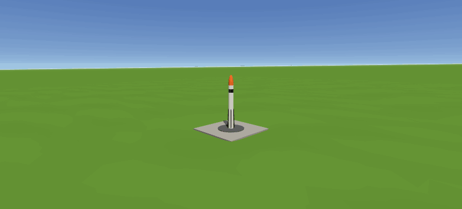

# TVC Rocket Firmware



Flight software and a 6-DOF simulator for a propulsive landing model rocket, in the style of
BPS.space Scout and Project Horizon's Eagle. One Estes F15 goes up, a second F15 stacked on top
lands it, steering with a gimbaled motor mount and paddles that throttle the landing motor.

**[Watch it fly in your browser](https://jamesgossy.github.io/TVC_Rocket_Firmware/)**: the normal
flight plus 20 random ones with different wind, motors and igniters.

**95% good landings** over 2000 random flights, with realistic servos, sensors, wind and ground.
98% in wind under 2 m/s.

## How it lands

The flight software is about 175 lines (`flight_software/flight_computer.cpp`) and is kept apart
from the physics so it can run on the real flight computer.

1. **Pad:** average the sensors for two seconds to learn the gyro bias and which way is up.
2. **Boost:** PD control on the gimbal keeps the nose straight up.
3. **Coast:** light the landing motor once braking at 3.5 m/s² would just stop it at the ground,
   looking ahead by the igniter delay. If it'll be tipped way over, wait a moment for the tumble
   to swing back.
4. **Landing burn:** the paddles follow a braking curve (falling too fast, open them, too slow,
   close them), and the gimbal leans against any sideways drift so the legs don't touch down
   sliding.

Attitude comes from the gyro, altitude from the accelerometer and barometer, and velocity from
the accelerometer corrected by GPS. Everything that didn't measurably help got cut.

## The rocket

| | |
|---|---|
| Motors | 2x Estes F15-0, stacked. The landing motor kicks the spent one out |
| Mass | 0.9 kg dry, about 1.1 kg at liftoff |
| Steering | 2 axis gimbal, ±10° |
| Throttle | paddles in the landing motor's exhaust, down to 60% thrust |
| Legs | 4, 0.7 m across, 6 cm of damped stroke |
| Sensors | BMI088 or ICM-42688-P IMU, MS5611 or BMP390 barometer, u-blox M9/M10 GPS |
| Fins | none |

## Run it

Needs g++ and make (MSYS2 UCRT64 works on Windows).

```
make
./tvc_sim                    # one flight, writes flight.csv
./tvc_sim random             # one flight with random wind, motors, igniters...
./tvc_sim montecarlo 1000    # 1000 random flights, writes montecarlo.csv
python tools/view.py         # watch flights in 3D (flies the sim live)
python tools/plot.py         # plots of the last flight
```

Every number lives in `rocket.cfg`, which explains each one, so trying a new design needs no
recompiling. `python tools/view.py --web` refreshes the flights the online viewer plays.

`validation/compare_rocketpy.py` checks the physics against RocketPy: same apogee to the
centimeter, and a finless rocket tips over at the same moment in both.

## What's in here

```
flight_software/   the firmware: states, estimating, steering, landing burn
common/            shared maths, motor curves, config, mass properties
sim/               physics, hardware and sensor models, the flight loop, Monte Carlo
docs/              the 3D viewer (also the GitHub Pages site) and its saved flights
tools/             view.py and plot.py
validation/        comparison against RocketPy
```

## Things the sim taught me

- **No fins means it tumbles between the two burns,** and wind makes it worse. Most failures left
  are flights the wind flipped nearly upside down before the landing motor lit.
- **Paddles are what make it work.** Without them the landing is at the mercy of the igniter
  timing (about ±180 ms), and the best I got was 42%.
- **Wide legs beat strong legs.** Touchdowns are gentle (about 2 m/s); tipping over is what kills
  landings.
- **Keep the CG low.** Raising it 5 cm drops landings from 95% to under 60%. The aero numbers for
  falling tail first are still guesses, so this needs a drop test.
- **Fly on calm days** (under about 4 m/s) from a flat, mown field.

Ideas came from BPS.space (Scout E and F), Project Horizon's Eagle, Landing-Rocket-Sim, and
Apollo's descent guidance.
